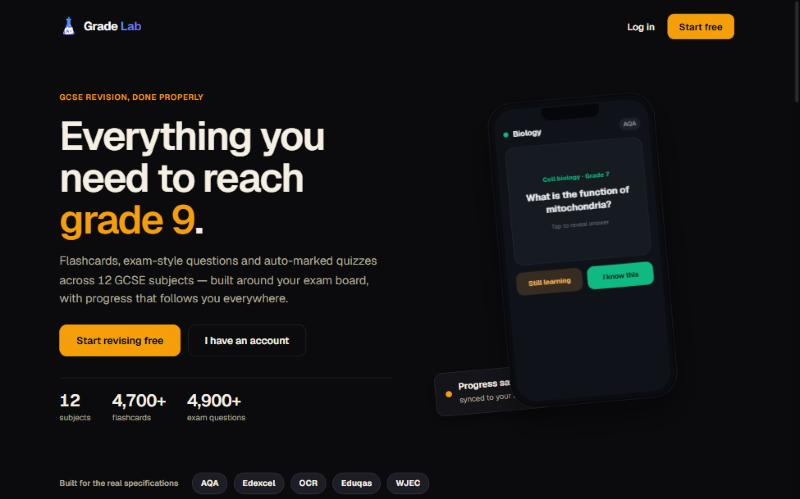

# Grade Lab

[](https://github.com/callumtsungu200-coder/Grade-Lab/actions/workflows/ci.yml)

A GCSE revision platform: flashcards, exam-style questions, auto-marked quizzes and official past papers, matched to each exam board's specification.

**Live:** [gradelab.netlify.app](https://gradelab.netlify.app)



## Why I built it

I started Grade Lab as a flashcard app for the seven subjects I was revising myself. Most free revision tools are not matched to a specific exam board, and flashcard apps rarely know whether a fact is Higher tier only or for separate sciences only, so students waste time on content they will never be examined on. Grade Lab splits every subject the way the board's specification does.

## What's in it

| Subject | Specification | Topics | Flashcards |
| --- | --- | ---: | ---: |
| Mathematics | Edexcel 1MA1 | 32 | 238 |
| Biology | AQA 8461 | 24 | 428 |
| Chemistry | AQA 8462 | 45 | 371 |
| Physics | AQA 8463 | 37 | 266 |
| Computer Science | OCR J277 | 11 | 236 |
| Media Studies | Eduqas | 20 | 910 |
| History | Edexcel 1HI0 | 15 | 270 |
| English Literature | AQA 8702 | 12 | 189 |
| Business Studies | AQA 8132 | 29 | 197 |
| Citizenship Studies | Edexcel 1CS0 | 22 | 174 |
| Religious Studies | AQA 8062 | 58 | 303 |
| Spanish | AQA 8692 | 23 | 1,146 |

That is 4,728 flashcards, plus 4,950 exam-style questions across 11 subjects, each tagged with a target grade from 4 to 9. The figures come from the data files, and the test suite checks that every card and question is well-formed.

## Features

- **Flashcards** with tier filters (Higher tier, separate-science only), shuffle and keyboard shortcuts.
- **Spaced repetition.** Cards you know come back after 3, 7, 14, 30 and then 60 days; cards you're still learning come back the next day. Reviewing early doesn't push a card further out, so cramming a deck twice in one evening doesn't hide it for months.
- **Exam-style questions** grouped by grade, with self-marking, and **auto-marked quizzes**.
- **Past papers** from AQA, Edexcel, OCR, Eduqas and WJEC, shown in an in-app PDF viewer.
- **Accounts and sync.** Progress is saved in the browser and synced to the cloud when you sign in, with a merge that never overwrites newer progress.
- **Gamification:** XP, levels, ranks, a currency earned from real study activity, a shop and a global leaderboard.
- **Installable PWA** that works offline after the first visit.
- **Subscriptions** through Stripe, with a free allowance of sets for every account.
- **Owner dashboard** for managing accounts.

## Tech stack

| Area | Technology |
| --- | --- |
| Front end | React 18, Vite 5, Framer Motion, JavaScript migrating to TypeScript |
| Back end | Supabase (Postgres, auth, row-level security, edge functions) |
| Payments | Stripe Payment Links and a webhook edge function |
| Hosting | Netlify static hosting plus one Netlify Function |
| PDFs | pdf.js |
| Offline | vite-plugin-pwa (Workbox) |
| Bot protection | Cloudflare Turnstile |
| Tests and CI | Vitest, `tsc`, GitHub Actions |

## Architecture

```
Browser (React SPA, service worker)
 ├─ src/data/*.js, src/questions/*.js   all revision content, bundled with the app
 ├─ localStorage                          progress, spaced-repetition schedule, settings
 ├─ Supabase JS client ──► Supabase       auth, profiles, user_progress, leaderboard, past papers
 ├─ Stripe Payment Link ──► Stripe ──► supabase/functions/stripe-webhook ──► profiles.paid
 └─ /api/pdf ──► netlify/functions/pdf.mjs ──► exam-board servers
```

- **Content is code.** Each subject is a JavaScript module of topics and `[question, answer, tier]` cards. `src/subjects.js` registers the subjects and gives each card a stable id.
- **Progress lives on the device first.** Marks and schedules are written to `localStorage` straight away. When you're signed in, `src/progressSync.ts` merges the local copy with the single JSON row in `user_progress`. The merge is a pure function, so it is unit-tested.
- **Row-level security.** Every table is protected by policies in the `supabase-*.sql` files. The browser only ever holds the public anon key.
- **The PDF proxy** exists because exam-board sites block embedding and cross-origin requests, and iOS can't render PDFs in an iframe. The function only accepts the boards' own hostnames, so it can't be used as an open proxy. `vite.config.js` has a matching dev-server version.

```
src/
  App.jsx              app state, switching between views, sync
  components/          views (Dashboard, StudyView, QuizView, PastPapersView, ...)
  data/                flashcard decks, one file per subject
  questions/           exam-style question banks, one file per subject
  srs.ts               spaced repetition (pure helpers plus storage)
  progressSync.ts      local/cloud progress merge
  gamification.js      XP, levels and currency, derived from study activity
  supabaseClient.js    all database calls
  supabaseConfig.js    public project settings (URL, anon key, payment links)
netlify/functions/     PDF proxy
supabase/functions/    Stripe webhook
supabase-*.sql         database schema and policies
```

## Running it locally

Requires Node 20+.

```bash
npm install
npm run dev          # http://localhost:5173
```

| Command | What it does |
| --- | --- |
| `npm test` | Unit and content tests (Vitest) |
| `npm run typecheck` | TypeScript check |
| `npm run build` | Production build to `dist/` |
| `npm run preview` | Serve the production build |

The app runs without any environment variables. `src/supabaseConfig.js` points at the live Supabase project and only contains values that are designed to be public (the anon key, the Turnstile site key and the payment links).

### Using your own backend

1. Create a Supabase project and run `supabase-setup-all.sql` in the SQL editor.
2. Put your project URL and anon key in `src/supabaseConfig.js`.
3. To take payments, deploy the webhook with `supabase functions deploy stripe-webhook --no-verify-jwt` and set these secrets in Supabase (never in this repo):

| Secret | Where it comes from |
| --- | --- |
| `STRIPE_SECRET_KEY` | Stripe dashboard, API keys |
| `STRIPE_WEBHOOK_SECRET` | The Stripe webhook endpoint you create |

`SUPABASE_URL` and `SUPABASE_SERVICE_ROLE_KEY` are provided to edge functions automatically.

### Deploying

`netlify.toml` contains the build command, the publish folder, the function directory and the SPA fallback. Connect the repository in Netlify and every push to `main` deploys. Dragging `dist/` onto Netlify also works, but it doesn't include the PDF function, so some past papers open in a new tab instead.

## Adding content

Open `src/data/<subject>.js`. Each topic has a `cards` array of `[question, answer, tier]`, where `tier` is `""` (everyone), `"HT"` (Higher tier) or a separate-science code such as `"BO"` (Biology only). Run `npm test` afterwards: the content tests fail on empty cards, duplicate ids and out-of-range grades.

## Known limitations

- All content is in one JavaScript bundle (about 950 kB gzipped), so the first load is heavy. The service worker caches it after that.
- The codebase is part JavaScript, part TypeScript. New modules are written in TypeScript.
- Religious Studies questions cover Christianity, Islam and the six themes, but not the other religions yet. Spanish has flashcards but no question bank yet.

## What's next

- Load each subject's content only when it's opened, to cut the first download.
- AI marking of written answers.
- Move the remaining JavaScript modules to TypeScript.
- Tests for the free-set allowance and the gamification maths.

## Contributing

Spotted a wrong answer or a typo in a card? Open an issue with the subject, the topic and the card text. For code changes, open a pull request; CI runs the type check, tests and build.

## Licence

No licence has been added yet, so the code isn't licensed for reuse. Exam-board names and past papers belong to their respective boards.
